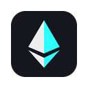

# ETH Price by cp0x

A Chrome extension that keeps the current ETH price on your toolbar and updates it every 30 seconds.
It talks to Binance and Coinbase directly and collects no data.

## Why

I wanted one simple thing in my browser: the ETH price, always in sight. The ticker extensions I tried in the
Chrome Web Store kept breaking. The last one I used routed prices through its developer's own server. So I wrote
a small one that asks the exchanges directly, with a fallback when one of them does not answer. Feel free to use it.

## What you get

- The badge shows the price in whole dollars (`2418`). From $10,000 on it switches to `10.2k`.
- The badge turns green when the price went up since the previous update and red when it went down. If the price
  did not change, the color stays. The first reading after the browser starts is graphite.
- Hover over the icon to see the exact price, the source and the time of the last update.
- Click the icon to refresh right away.
- If neither exchange answers, the badge keeps the last known price on a grey background and the tooltip shows the
  error.

## Install

The extension is not in the Chrome Web Store yet. To install it from source:

1. Download this repository (**Code → Download ZIP**) and unzip it, or run
   `git clone https://github.com/cp0x-org/eth-price-badge.git`.
2. Open `chrome://extensions` and switch on **Developer mode** in the top right corner.
3. Click **Load unpacked** and select the folder with `manifest.json`.
4. Click the puzzle icon in the toolbar and pin **ETH Price by cp0x**.

To update, pull or download the new version and press the reload button on the extension card in
`chrome://extensions`.

## Where the price comes from

1. Binance spot ETH/USDT, `https://api.binance.com/api/v3/ticker/price?symbol=ETHUSDT`. Binance quotes ETH in USDT,
   which can differ from USD by a fraction of a percent.
2. Coinbase spot ETH-USD, `https://api.coinbase.com/v2/prices/ETH-USD/spot`, used when Binance returns an error,
   does not answer within 10 seconds or returns something that is not a price. If Binance is not available where you
   are, you get the Coinbase price automatically.

The tooltip always names the exchange the current price came from.

## Privacy and permissions

The extension makes anonymous HTTPS requests to the two public endpoints above and nothing else. It keeps the last
price in Chrome session storage on your computer, which Chrome clears when the browser closes. There are no
analytics, accounts or remote code. Details are in [PRIVACY.md](PRIVACY.md).

| Permission | Why |
|---|---|
| `alarms` | wake up every 30 seconds to fetch the price |
| `storage` | remember the previous price to color the badge |
| `https://api.binance.com/*`, `https://api.coinbase.com/*` | read the public price |

## How it works

It is a Manifest V3 extension in plain JavaScript with no dependencies and no build step.

- `price.js` has the logic: price sources, the request with a timeout and a fallback, the badge and tooltip text,
  the colors.
- `background.js` is the service worker. Chrome puts extension service workers to sleep when they are idle, so the
  timer is a `chrome.alarms` alarm with a 30-second period (the shortest Chrome allows). The previous price lives in
  `chrome.storage.session`, so the badge color survives the worker going to sleep.

## Development

```
node --test
```

The tests use fake `fetch` and `chrome` objects and run without a browser or network (tested on Node.js 22).
The contract of each module is written at the top of its test file.

## License

[MIT](LICENSE)

Made by [cp0x](https://cp0x.com).
